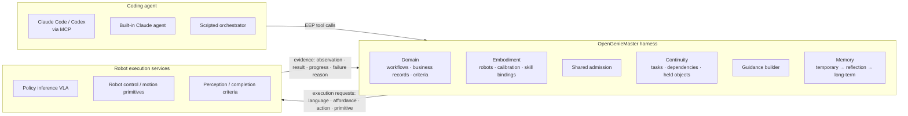

# OpenGenieMaster

[中文](https://github.com/eust-w/opengeniemaster/blob/main/README.md) | English

[](https://github.com/eust-w/opengeniemaster/actions/workflows/ci.yml)
[](https://pypi.org/project/opengeniemaster/)
[](https://github.com/eust-w/opengeniemaster/blob/main/pyproject.toml)
[](https://github.com/eust-w/opengeniemaster/blob/main/LICENSE)

**An open embodied continual harness for persistent multi-robot work**: an independent, open-source re-implementation of [GenieMaster](https://genie-master.github.io/), the embodied agent framework that AgiBot announced on 2026-10-27.

A coding agent (Claude Code, Codex, or the built-in Claude agent) works through the **EEP (Embodied Execution Protocol)**. It calls robot capabilities, sends multimodal guidance, reads physical feedback, and resumes tasks after interruptions. It also reflects what it learns on the job into long-term memory, without changing any policy weights. EEP is served as an MCP server, so any MCP-capable coding agent can connect directly.

> OpenGenieMaster is maintained independently by the community. It is not affiliated with, authorized by, or partnered with AgiBot. When this was written, the official GenieMaster code had not been released (the project page says "Coming soon"). This repository re-implements the design from the official project page, the paper's figures, and public reports. The protocol's wire format, defaults, and error codes are this project's own, and **compatibility with the official implementation is not guaranteed**. See the [research notes](https://github.com/eust-w/opengeniemaster/blob/main/docs/research/genie-master-2026-10-27.md) (in Chinese).

## What is re-implemented

| Component described for GenieMaster | Implementation in this repository |
| --- | --- |
| The four EEP contracts: Capability / Guidance / Feedback / Continuity | `opengeniemaster/eep/`, keeping the published field names (`observation`, `action_result`, `failure_reason`; `task_id`, `completed_steps`, `assigned_robot`, `pending_work`) |
| Domain interfaces (task semantics, composed commands, business records, task criteria) | `domain/`: workflows and composed tools for three domains: convenience store, office, and home |
| Embodiment interfaces (robot instances, bindings, calibration, execution services) | `embodiment/`: robot profiles, skill-to-service bindings, calibration, and three execution adapters (simulator, HTTP, replay) |
| Coding agent: Task Context → Orchestrate → Execution Feedback → Recovery → Reflection | `harness/` + `agents/`: an EEP-over-MCP server, a built-in Claude agent, and a deterministic scripted orchestrator |
| Agent–policy multimodal guidance (spatial boxes and points, object reference images, detailed language) | `harness/guidance.py`: builds guidance to match how each robot's policy was trained (co-design) |
| Execution feedback: criteria and evidence | `harness/criteria.py`: completion criteria decide success, not the policy's own report |
| Shared Admission (validate · admit) | `harness/admission.py`: request admission, a safety interlock, and admission of memory proposals |
| Persistent multi-robot work, resuming after interruptions, multi-robot coordination | `harness/continuity.py`: work items bound to robots, dependencies, held objects, and pending work; dispatch and handoff |
| Temporary memory → asynchronous reflection → long-term memory (domain / embodiment memory), with weights unchanged | `memory/`: execution records, versioned long-term memory (diff and rollback), and rule-based and LLM reflectors |
| Replay · Offline tests | `replay.py`: replays recorded robot responses request by request to catch behaviour regressions |
| Policy RSI (train the policy on filtered, weighted, goal-relabelled data) | `flywheel.py`: exports training samples from execution logs (training itself is out of scope) |
| Capability gaps → self-directed practice while idle | `harness/practice.py` |

The item-by-item mapping and design trade-offs are in [docs/architecture.md](https://github.com/eust-w/opengeniemaster/blob/main/docs/architecture.md), and the protocol specification is in [docs/eep-spec.md](https://github.com/eust-w/opengeniemaster/blob/main/docs/eep-spec.md). Both are in Chinese.



## Installation

OpenGenieMaster needs Python 3.10 or newer, and its core has **no third-party dependencies**. The `python3` that ships with macOS may be 3.9; if so, use a newer interpreter (for example, `uv python install 3.12`).

```bash
pip install opengeniemaster
```

For the built-in Claude agent, install the extra that includes the Anthropic SDK:

```bash
pip install "opengeniemaster[claude]"
```

Or install from source:

```bash
git clone https://github.com/eust-w/opengeniemaster.git
cd opengeniemaster
pip install -e .
```

## Quick start

```bash
ogm demo --scenario restocking --rounds 3 --trials 6
```

If you haven't installed the package, run `python3 -m opengeniemaster` from the repository root instead of `ogm`.

The demo repeats a restocking task in a simulated convenience store and reflects after each round. Output from one run:

```text
round 1: success 5/6, recoveries 14, memory admitted 3 -> 3 entries
round 2: success 6/6, recoveries 13, memory admitted 1 -> 4 entries
round 3: success 5/6, recoveries 7, memory admitted 1 -> 5 entries

Long-term memory:
  [embodiment/guidance] Keep the gripper closed during retraction and travel; release only at placement.
  [embodiment/guidance] For hang (hook, hooks, at a hook wall, small), the head camera cannot localize the target
                        reliably; approach and localize with the wrist camera first.
  ...
```

These two lessons match cases published on the GenieMaster project page. In one, a price tag hides a small hook from the head camera, so the robot switches to the wrist camera and localizes the hook at close range. In the other, the gripper opens while retracting, so it must stay closed in transit. Here, both lessons are **learned automatically** from execution records through reflection and admission.

Other useful commands:

```bash
ogm scenarios            # list the simulated scenarios
ogm demo -v              # demo with per-trial output
ogm bench --experiment all --out results   # all experiments, about 20 seconds
```

## Using Claude Code or Codex as the coding agent

The GenieMaster architecture puts coding agents such as Claude Code, Codex, Kimi, and DeepSeek at the center of the harness. This repository exposes EEP as an MCP server (stdio, standard library only), so these agents can act as the coding agent directly.

For Claude Code:

```bash
claude mcp add opengeniemaster -- ogm mcp --scenario restocking --state-dir .ogm
```

You can also copy [examples/claude_code.mcp.json](https://github.com/eust-w/opengeniemaster/blob/main/examples/claude_code.mcp.json) to `.mcp.json` in your project root. The Codex configuration is in [examples/codex_config.toml](https://github.com/eust-w/opengeniemaster/blob/main/examples/codex_config.toml). If you run from a source checkout without installing, replace `ogm` with `python3 -m opengeniemaster` and start the agent from the repository root.

Once the agent is connected, have it read the MCP prompt `geniemaster_operator` (the full operating procedure), then give it a goal such as "restock the missing items". The main tools are:

| Contract | Tools |
| --- | --- |
| Capability | `eep_capabilities`, `<domain>_lookup`, `<domain>_orders`, `store_inspect_shelf` |
| Continuity | `eep_task_create`, `eep_task_get`, `eep_task_list`, `eep_task_update` (pause / resume / retry / skip / handoff …), `eep_dispatch` |
| Guidance + Feedback | `eep_suggest_guidance`, `eep_execute`, `eep_observe`, `eep_verify`, `eep_wait` |
| Safety | `eep_robot_stop`, `eep_robot_resume` (plus the person-in-workspace interlock in admission) |
| Memory and reflection | `memory_records`, `memory_propose`, `memory_search`, `memory_note`, `memory_reflect`, `eep_capability_gaps` |

`--state-dir .ogm` keeps long-term memory, task state, and the event log across sessions.

## Built-in Claude agent

Without an external agent, the built-in agent can drive the harness with Claude directly. It needs the Anthropic Python SDK and API credentials:

```bash
pip install "opengeniemaster[claude]"
ogm agent --scenario office_supply_search            # defaults to claude-opus-5-5, effort=high
ogm reflect --state-dir .ogm --llm                   # reflect with Claude
```

The built-in agent turns on server-side `fallbacks: "default"`: when a safety classifier declines a request, the API retries it on the recommended fallback model. Turn this off with `ClaudeAgent(server_fallbacks=False)`.

## Connecting real robots

A robot only needs a small HTTP/JSON execution service (`/eep/v0/execute`, `/observe`, `/check`, `/state`, `/stop`) to join the harness:

1. Subclass `opengeniemaster.embodiment.service.RobotBackend`, call your VLA inference service, whole-body controller, and detectors from it, then start it with `serve()`. [examples/human_backend.py](https://github.com/eust-w/opengeniemaster/blob/main/examples/human_backend.py) is a runnable human-in-the-loop backend: an operator carries out each request by teleoperation and reports the result, so you can try the whole loop before connecting a policy.
2. Write a fleet file ([examples/fleet.json](https://github.com/eust-w/opengeniemaster/blob/main/examples/fleet.json)) with each robot's model, endpoint, token, and calibration version, plus business records ([examples/records.json](https://github.com/eust-w/opengeniemaster/blob/main/examples/records.json)).
3. Start `ogm mcp --fleet examples/fleet.json --state-dir .ogm`.

On safety, shared admission rejects a request when:

- the robot is stopped;
- its calibration is invalid;
- the step's dependencies are not done; or
- a person has been seen in the workspace and the request does not declare a pause.

`eep_robot_stop` is an emergency stop you can use at any time. Tasks with unfinished work on that robot pause and continue only after an explicit resume or a handoff, picking up at the next unfinished step.

**This repository has not been verified on real robots.** Before connecting real hardware, make sure emergency stops, human takeover, and motion limits are in place.

## Simulation benchmarks

`ogm bench` reproduces the paper's five kinds of experiments in the built-in semantic simulator. The simulator explicitly models these failure mechanisms:

- price tags hiding hooks from the camera;
- look-alike products;
- new products the policy never saw in training;
- the gripper opening while retracting;
- people entering the workspace;
- action-service outages;
- detectors misjudging results from a distance.

Results for 6 tasks, with 100 trials per task and method, are below. Full results and methodology are in [docs/benchmarks.md](https://github.com/eust-w/opengeniemaster/blob/main/docs/benchmarks.md) (in Chinese).

| Method | Success rate (SR) % | Task completion (TC) % |
| --- | --- | --- |
| End-to-end VLA (given only the overall goal) | 12.50 | 41.50 |
| Dual-system (VLM planner + policy, language guidance) | 21.00 | 53.52 |
| OpenGenieMaster (no long-term memory) | 90.67 | 96.90 |
| OpenGenieMaster (memory from 10 warm-up trials) | 93.17 | 97.68 |
| Oracle orchestration (reads simulator ground truth; an upper reference) | 95.50 | 98.37 |

> These are **simulation regression results**: they check that the harness mechanisms work as designed. The simulator's probability parameters are documented assumptions ([sim/policy.py](https://github.com/eust-w/opengeniemaster/blob/main/opengeniemaster/sim/policy.py)). These numbers are not physical-robot results and cannot be compared with those in the GenieMaster paper.

## Repository layout

```text
opengeniemaster/
  eep/          protocol data model, JSON Schema, error codes
  domain/       domain layer: business records, workflows, composed tools (store / office / home)
  embodiment/   embodiment layer: robot profiles and skill bindings, execution adapters, robot-side HTTP service
  harness/      harness core: continuity, admission, criteria, guidance, recovery, orchestrator, practice
  memory/       temporary and long-term memory, reflectors
  agents/       EEP tool registry, MCP server, built-in Claude agent, prompts
  sim/          semantic multi-robot simulator and scenarios
  bench/        baseline methods, experiments, and reports
  replay.py     replay-based offline regression tests
  flywheel.py   Policy RSI data export (filter / weight / relabel)
  cli.py        the ogm command line
tests/          100 unit, integration, and regression tests (unittest, no dependencies)
docs/           architecture mapping, EEP spec, benchmarks, research notes (Chinese)
examples/       MCP configs, fleet file, business records, human-in-the-loop backend
```

## Contributing

Issues and pull requests are welcome, in English or Chinese. Before you start, please read:

- the [contributing guide](https://github.com/eust-w/opengeniemaster/blob/main/CONTRIBUTING.md): development setup, tests, commit conventions, and the release process;
- the [code of conduct](https://github.com/eust-w/opengeniemaster/blob/main/CODE_OF_CONDUCT.md);
- the [security policy](https://github.com/eust-w/opengeniemaster/blob/main/SECURITY.md): report security issues privately through GitHub, not in public issues;
- the [changelog](https://github.com/eust-w/opengeniemaster/blob/main/CHANGELOG.md).

Run the tests with:

```bash
python3 -m unittest discover -s tests -v
```

CI ([.github/workflows/ci.yml](https://github.com/eust-w/opengeniemaster/blob/main/.github/workflows/ci.yml)) runs the tests, a CLI smoke test, and a package build on Python 3.10–3.13. When a GitHub release is published, the [release workflow](https://github.com/eust-w/opengeniemaster/blob/main/.github/workflows/release.yml) builds the package and uploads it to PyPI through Trusted Publishing.

## Limitations

- No policy or model weights are trained or distributed. Policy RSI stops at exporting training data.
- The simulator is semantic (skill outcomes are probabilistic) and does not simulate physics. Physics backends such as Genie Sim, Isaac, or MuJoCo could be connected through an execution adapter, but none is implemented yet.
- The field-level EEP specification comes from the public description on the official project page. Message envelopes, error semantics, and version negotiation are this project's own design (`open-eep/0.1`).
- Nothing has been verified on real robots; every benchmark number comes from simulation.

## License

The original content of this repository is released under the [MIT License](https://github.com/eust-w/opengeniemaster/blob/main/LICENSE). Cited external material keeps its own copyright and license. This repository's license grants no rights to external code, model weights, or media.

GenieMaster, Genie, AgiBot, and related names and logos belong to their respective owners. This project uses those names only to identify what it studies and re-implements. Their use does not imply any endorsement or affiliation.
