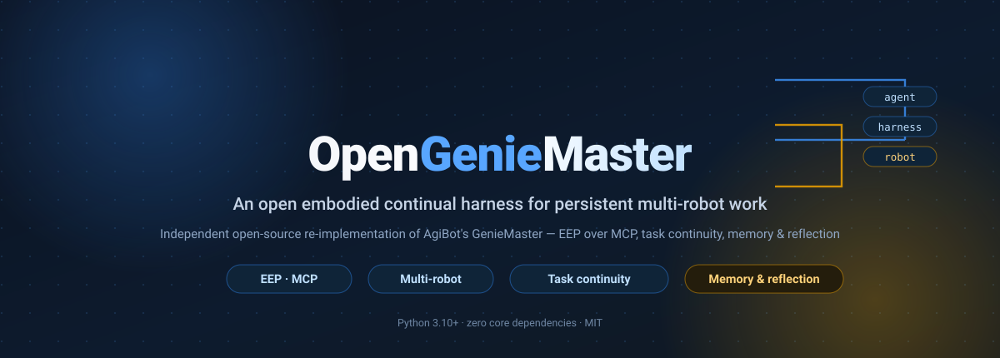
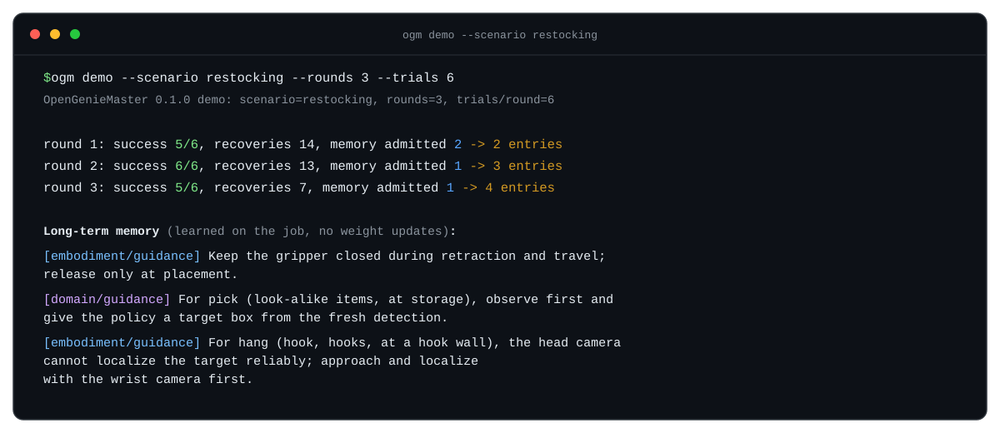

<p align="center">
  
</p>

[中文](README.md) | English

[](https://github.com/eust-w/opengeniemaster/actions/workflows/ci.yml)
[](https://pypi.org/project/opengeniemaster/)
[](https://github.com/eust-w/opengeniemaster/blob/main/pyproject.toml)
[](https://github.com/eust-w/opengeniemaster/blob/main/LICENSE)

**OpenGenieMaster** is an open, embodied continual harness for persistent multi-robot work — an independent, open-source re-implementation of [GenieMaster](https://genie-master.github.io/), the embodied agent framework that AgiBot announced on 2026-10-27.

A coding agent (Claude Code, Codex, or the built-in Claude agent) drives the harness through the **EEP (Embodied Execution Protocol)**: it calls robot capabilities, sends multimodal guidance, reads physical feedback, and resumes tasks after interruptions — then reflects what it learned into long-term memory without touching any policy weights. EEP is served as an **MCP server**, so any MCP-capable coding agent connects directly.

> **Independent project.** OpenGenieMaster is maintained by the community and is not affiliated with, authorized by, or partnered with AgiBot. When this was written the official GenieMaster code had not been released (the project page says "Coming soon"), so this repository re-implements the design from the project page, the paper's figures, and public reports. The protocol's wire format, defaults, and error codes are this project's own, and **compatibility with the official implementation is not guaranteed**. See the [research notes](docs/research/genie-master-2026-10-27.md) (in Chinese).

## Highlights

- **Zero dependencies.** The core is pure Python 3.10+ standard library — no policy, no model weights, nothing to install but Python.
- **EEP over MCP.** Embodied capabilities, multimodal guidance, physical feedback, and task continuity are exposed as MCP tools over stdio.
- **Task continuity.** Work items bind to robots with dependencies and held objects; interrupted tasks pause and resume at the next unfinished step, with dispatch and handoff across a fleet.
- **Shared admission.** Every request passes a safety interlock — stopped robot, invalid calibration, missing dependencies, or a person in the workspace is refused.
- **Memory & reflection.** Execution records are reflected into versioned long-term memory (diffable, rollback-able) with policy weights unchanged.
- **Regression-tested simulator.** A semantic multi-robot simulator models seven documented failure mechanisms and reproduces the paper's five experiment families.

## Architecture

<p align="center">
  
</p>

The item-by-item mapping from GenieMaster's published design and the design trade-offs are in [docs/architecture.md](docs/architecture.md); the protocol specification is in [docs/eep-spec.md](docs/eep-spec.md). Both are in Chinese.

## Quick start

Install from source (see [Installation](#installation)) and run:

```bash
ogm demo --scenario restocking --rounds 3 --trials 6
```

<p align="center">
  
</p>

The demo repeats a restocking task in a simulated convenience store and reflects after each round. Two of the learned lessons match cases published on the GenieMaster project page — a price tag hides a hook from the head camera (switch to the wrist camera), and the gripper opens while retracting (keep it closed in transit). Here both are **learned automatically** from execution records through reflection and admission.

```bash
ogm scenarios            # list the simulated scenarios
ogm demo -v              # demo with per-trial output
ogm bench --experiment all --out results   # all experiments, about 20 seconds
```

## Benchmarks

`ogm bench` reproduces the paper's five experiment families in the built-in semantic simulator, which explicitly models price-tag occlusion, look-alike products, unseen products, gripper slip during retraction, people entering the workspace, action-service outages, and long-range detector misjudgements.

**Overall success rate and task completion** (6 tasks, 100 trials per method):

<p align="center">
  
</p>

**Capability composition** — success rate as each capability is added:

<p align="center">
  
</p>

**Learning from experience** — long-term memory raises success rate and holds it steady across rounds:

<p align="center">
  
</p>

**Unseen-product generalization** — EEP guidance keeps success rate high on products the policy never trained on:

<p align="center">
  
</p>

**Persistent multi-robot deployment** — one simulated 24-hour shift:

<p align="center">
  
</p>

> These are **simulation regression results**: they check that the harness mechanisms work as designed. The simulator's probability parameters are documented assumptions ([sim/policy.py](opengeniemaster/sim/policy.py)). They are not physical-robot results and cannot be compared with the GenieMaster paper. Full results and methodology are in [docs/benchmarks.md](docs/benchmarks.md) (in Chinese).

## Installation

OpenGenieMaster needs Python 3.10 or newer, and its core has **no third-party dependencies**. The `python3` that ships with macOS may be 3.9; if so, use a newer interpreter (for example, `uv python install 3.12`).

> **Not on PyPI yet.** `pip install opengeniemaster` does not work yet, so install from source for now. This note will be removed once the package is on PyPI.

```bash
git clone https://github.com/eust-w/opengeniemaster.git
cd opengeniemaster
pip install -e .
```

For the built-in Claude agent, use `pip install -e ".[claude]"` as the last step instead; it also installs the Anthropic SDK.

Once the package is on PyPI, you will also be able to run:

```bash
pip install opengeniemaster            # core
pip install "opengeniemaster[claude]"  # with the built-in Claude agent
```

## Use Claude Code or Codex as the coding agent

GenieMaster puts coding agents such as Claude Code, Codex, Kimi, and DeepSeek at the center of the harness. EEP is an MCP server (stdio, standard library only), so these agents act as the coding agent directly:

```bash
claude mcp add opengeniemaster -- ogm mcp --scenario restocking --state-dir .ogm
```

You can also copy [examples/claude_code.mcp.json](examples/claude_code.mcp.json) to `.mcp.json` in your project root; the Codex configuration is in [examples/codex_config.toml](examples/codex_config.toml). Running from a source checkout without installing, replace `ogm` with `python3 -m opengeniemaster` and start the agent from the repository root.

Have the agent read the MCP prompt `geniemaster_operator` (the full operating procedure), then give it a goal such as "restock the missing items". The main tools:

| Contract | Tools |
| --- | --- |
| Capability | `eep_capabilities`, `<domain>_lookup`, `<domain>_orders`, `store_inspect_shelf` |
| Continuity | `eep_task_create`, `eep_task_get`, `eep_task_list`, `eep_task_update` (pause / resume / retry / skip / handoff …), `eep_dispatch` |
| Guidance + Feedback | `eep_suggest_guidance`, `eep_execute`, `eep_observe`, `eep_verify`, `eep_wait` |
| Safety | `eep_robot_stop`, `eep_robot_resume` (plus the person-in-workspace interlock in admission) |
| Memory & reflection | `memory_records`, `memory_propose`, `memory_search`, `memory_note`, `memory_reflect`, `eep_capability_gaps` |

`--state-dir .ogm` keeps long-term memory, task state, and the event log across sessions.

## Built-in Claude agent

Without an external agent, the built-in agent drives the harness with Claude directly (needs the Anthropic SDK and API credentials):

```bash
pip install -e ".[claude]"                           # from the repository root; later: pip install "opengeniemaster[claude]"
ogm agent --scenario office_supply_search            # defaults to claude-opus-5-5, effort=high
ogm reflect --state-dir .ogm --llm                   # reflect with Claude
```

The built-in agent turns on server-side `fallbacks: "default"`: when a safety classifier declines a request, the API retries it on the recommended fallback model. Turn this off with `ClaudeAgent(server_fallbacks=False)`.

## Connect real robots

A robot only needs a small HTTP/JSON execution service (`/eep/v0/execute`, `/observe`, `/check`, `/state`, `/stop`) to join the harness:

1. Subclass `opengeniemaster.embodiment.service.RobotBackend`, call your VLA inference service, whole-body controller, and detectors from it, then start it with `serve()`. [examples/human_backend.py](examples/human_backend.py) is a runnable human-in-the-loop backend — an operator carries out each request by teleoperation and reports the result — so you can try the whole loop before connecting a policy.
2. Write a fleet file ([examples/fleet.json](examples/fleet.json)) with each robot's model, endpoint, token, and calibration version, plus business records ([examples/records.json](examples/records.json)).
3. Start `ogm mcp --fleet examples/fleet.json --state-dir .ogm`.

Shared admission rejects a request when the robot is stopped, its calibration is invalid, the step's dependencies are not done, or a person has been seen in the workspace and the request does not declare a pause. `eep_robot_stop` is an emergency stop you can use at any time.

**This repository has not been verified on real robots.** Before connecting real hardware, make sure emergency stops, human takeover, and motion limits are in place.

## Repository layout

```text
opengeniemaster/
  eep/          protocol data model, JSON Schema, error codes
  domain/       domain layer: business records, workflows, composed tools (store / office / home)
  embodiment/   embodiment layer: robot profiles and skill bindings, execution adapters, robot-side HTTP service
  harness/      harness core: continuity, admission, criteria, guidance, recovery, orchestrator, practice
  memory/       temporary and long-term memory, reflectors
  agents/       EEP tool registry, MCP server, built-in Claude agent, prompts
  sim/          semantic multi-robot simulator and scenarios
  bench/        baseline methods, experiments, and reports
  replay.py     replay-based offline regression tests
  flywheel.py   Policy RSI data export (filter / weight / relabel)
  cli.py        the ogm command line
tests/          100 unit, integration, and regression tests (unittest, no dependencies)
docs/           architecture mapping, EEP spec, benchmarks, research notes (Chinese)
examples/       MCP configs, fleet file, business records, human-in-the-loop backend
```

## Contributing

Issues and pull requests are welcome, in English or Chinese. Before you start, please read the [contributing guide](CONTRIBUTING.md), the [code of conduct](CODE_OF_CONDUCT.md), the [security policy](SECURITY.md), and the [changelog](CHANGELOG.md).

Run the tests with:

```bash
python3 -m unittest discover -s tests -v
```

CI ([.github/workflows/ci.yml](.github/workflows/ci.yml)) runs the tests, a CLI smoke test, and a package build on Python 3.10–3.13. When a GitHub release is published, the [release workflow](.github/workflows/release.yml) builds the package and uploads it to PyPI through Trusted Publishing.

## Limitations

- No policy or model weights are trained or distributed. Policy RSI stops at exporting training data.
- The simulator is semantic (probabilistic skill outcomes) and does not simulate physics. Physics backends such as Genie Sim, Isaac, or MuJoCo could be connected through an execution adapter, but none is implemented yet.
- The field-level EEP specification comes from the public description on the official project page. Message envelopes, error semantics, and version negotiation are this project's own design (`open-eep/0.1`).
- Nothing has been verified on real robots; every benchmark number comes from simulation.

## License

The original content of this repository is released under the [MIT License](LICENSE). Cited external material keeps its own copyright and license. This repository's license grants no rights to external code, model weights, or media.

GenieMaster, Genie, AgiBot, and related names and logos belong to their respective owners. This project uses those names only to identify what it studies and re-implements; their use does not imply any endorsement or affiliation.
