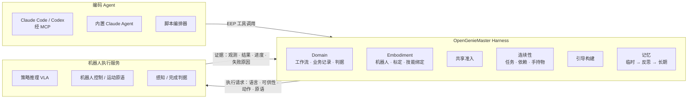

# OpenGenieMaster

中文 | [English](README.en.md)

[](https://github.com/eust-w/opengeniemaster/actions/workflows/ci.yml)
[](https://pypi.org/project/opengeniemaster/)
[](pyproject.toml)
[](LICENSE)

**面向持续多机器人作业的开源具身持续 Harness**：对智元 AGIBOT 于 2026-10-27 发布的具身 Agent 框架 [GenieMaster](https://genie-master.github.io/) 的独立开源复刻。

编码 Agent（Claude Code、Codex 或内置的 Claude Agent）通过 **EEP（Embodied Execution Protocol，具身执行协议）** 调用机器人能力、下发多模态引导、读取物理反馈、跨中断续接任务，并把作业经验反思进长期记忆，整个过程不改动策略权重。EEP 以 MCP 服务器的形式提供，任何支持 MCP 的编码 Agent 都可以直接接入。

> 本项目由社区独立维护，与智元 / AGIBOT 无隶属、授权或合作关系。GenieMaster 官方代码在本文撰写时尚未发布（项目主页标注 “Coming soon”）。本仓库依据官方项目主页、论文图表和公开报道复刻其设计；协议的线格式、默认值和错误码均为本项目自定，**不保证与官方实现兼容**。详见 [调研纪要](docs/research/genie-master-2026-10-27.md)。

## 复刻了什么

| GenieMaster 公开描述的组成 | 本仓库实现 |
| --- | --- |
| EEP 四类契约：Capability / Guidance / Feedback / Continuity | `opengeniemaster/eep/`，保留公开字段名（`observation`、`action_result`、`failure_reason`；`task_id`、`completed_steps`、`assigned_robot`、`pending_work`） |
| Domain 接口（任务语义、组合命令、业务记录、任务判据） | `domain/`：便利店、办公室、家居三个领域的工作流与组合工具 |
| Embodiment 接口（机器人实例、绑定、标定、执行服务） | `embodiment/`：机器人档案、技能与执行服务绑定、标定、仿真 / HTTP / 回放三种执行适配器 |
| 编码 Agent：Task Context → Orchestrate → Execution Feedback → Recovery → Reflection | `harness/` + `agents/`：EEP-over-MCP 服务器、内置 Claude Agent、确定性的脚本编排器 |
| Agent–Policy 多模态引导（空间框 / 点、物体参考图、细粒度语言） | `harness/guidance.py`：按机器人策略的训练方式组合引导（协同设计） |
| 执行反馈：判据与证据 | `harness/criteria.py`：不信任策略自报的成功，由完成判据决定 |
| Shared Admission（Validate · admit） | `harness/admission.py`：请求准入、安全联锁、记忆提案准入 |
| 持续多机器人作业、中断续接、多机协作 | `harness/continuity.py`：工作项与机器人绑定、依赖、手持物、待办；派工与交接 |
| 临时记忆 → 异步反思 → 长期记忆（Domain / Embodiment Memory），权重不变 | `memory/`：执行记录、版本化长期记忆（可 diff / 回滚）、规则反思器与 LLM 反思器 |
| Replay · Offline tests | `replay.py`：录制的机器人响应逐请求回放，检测行为回归 |
| Policy RSI（筛选、加权、目标重标后训练策略） | `flywheel.py`：从执行日志导出训练样本（训练本身不在本仓库范围内） |
| 能力缺口 → 闲时自主加练 | `harness/practice.py` |

逐项对照与设计取舍见 [docs/architecture.md](docs/architecture.md)，协议规范见 [docs/eep-spec.md](docs/eep-spec.md)。



## 安装

需要 Python ≥ 3.10，核心**没有任何第三方依赖**。macOS 自带的 `python3` 可能是 3.9，此时请换用较新的解释器（如 `uv python install 3.12`）。

> **PyPI 包暂未发布**：目前 `pip install opengeniemaster` 还装不上，请先从源码安装。PyPI 发布后会删掉这条说明。

从源码安装：

```bash
git clone https://github.com/eust-w/opengeniemaster.git
cd opengeniemaster
pip install -e .
```

需要内置 Claude Agent 时，把最后一步换成 `pip install -e ".[claude]"`，会一并安装 Anthropic SDK。

PyPI 发布后，也可以直接安装：

```bash
pip install opengeniemaster
```

需要内置 Claude Agent 时，安装附带 Anthropic SDK 的版本：

```bash
pip install "opengeniemaster[claude]"
```

## 快速开始

```bash
ogm demo --scenario restocking --rounds 3 --trials 6
```

未安装时，在仓库根目录用 `python3 -m opengeniemaster` 代替 `ogm`。

演示会在仿真便利店里重复执行补货任务，每轮结束后反思。下面是一次实际输出：

```text
round 1: success 5/6, recoveries 14, memory admitted 3 -> 3 entries
round 2: success 6/6, recoveries 13, memory admitted 1 -> 4 entries
round 3: success 5/6, recoveries 7, memory admitted 1 -> 5 entries

Long-term memory:
  [embodiment/guidance] Keep the gripper closed during retraction and travel; release only at placement.
  [embodiment/guidance] For hang (hook, hooks, at a hook wall, small), the head camera cannot localize the target
                        reliably; approach and localize with the wrist camera first.
  ...
```

这两条经验对应 GenieMaster 主页公开的案例：价签遮挡导致头部相机找不到小挂钩，于是改用腕部相机近距离定位；夹爪在回撤时松开，于是要求运输途中保持闭合。在本仓库里，它们是由执行记录经反思、准入后**自动学到**的。

其他常用命令：

```bash
ogm scenarios            # 列出仿真场景
ogm demo -v              # 带逐次输出的演示
ogm bench --experiment all --out results   # 全部评测，约 20 秒
```

## 让 Claude Code / Codex 当编码 Agent

GenieMaster 的架构图把 Claude Code、Codex、Kimi、DeepSeek 等编码 Agent 放在 Harness 中心。本仓库把 EEP 暴露为 MCP 服务器（stdio，纯标准库实现），因此这些 Agent 可以直接作为编码 Agent 使用。

Claude Code：

```bash
claude mcp add opengeniemaster -- ogm mcp --scenario restocking --state-dir .ogm
```

也可以把 [examples/claude_code.mcp.json](examples/claude_code.mcp.json) 复制为项目根目录下的 `.mcp.json`。Codex 的配置见 [examples/codex_config.toml](examples/codex_config.toml)。从源码运行而没有安装时，把 `ogm` 换成 `python3 -m opengeniemaster`，并在仓库根目录启动 Agent。

连接后，让 Agent 先读取 MCP prompt `geniemaster_operator`（完整的操作规程），然后给它一个目标，例如“把缺货的商品补上”。主要工具如下：

| 契约 | 工具 |
| --- | --- |
| Capability | `eep_capabilities`、`<domain>_lookup`、`<domain>_orders`、`store_inspect_shelf` |
| Continuity | `eep_task_create`、`eep_task_get`、`eep_task_list`、`eep_task_update`（暂停 / 恢复 / 重试 / 跳过 / 交接…）、`eep_dispatch` |
| Guidance + Feedback | `eep_suggest_guidance`、`eep_execute`、`eep_observe`、`eep_verify`、`eep_wait` |
| 安全 | `eep_robot_stop`、`eep_robot_resume`（另有准入层的人员闯入联锁） |
| 记忆与反思 | `memory_records`、`memory_propose`、`memory_search`、`memory_note`、`memory_reflect`、`eep_capability_gaps` |

`--state-dir .ogm` 会把长期记忆、任务状态和事件日志持久化，跨会话保留。

## 内置 Claude Agent

不使用外部 Agent 时，可以让内置 Agent 直接用 Claude 驱动 Harness（需要 Anthropic Python SDK 和 API 凭据）：

```bash
pip install -e ".[claude]"                           # 在仓库根目录执行；PyPI 发布后也可用 pip install "opengeniemaster[claude]"
ogm agent --scenario office_supply_search            # 默认 claude-opus-5-5，effort=high
ogm reflect --state-dir .ogm --llm                   # 用 Claude 做反思
```

内置 Agent 默认开启服务端 `fallbacks: "default"`：遇到安全分类器拒答时，由 API 自动换用推荐的备用模型重试。代码里可以通过 `ClaudeAgent(server_fallbacks=False)` 关闭。

## 接入真实机器人

机器人端只需实现一个很小的 HTTP/JSON 执行服务（`/eep/v0/execute`、`/observe`、`/check`、`/state`、`/stop`），即可接入 Harness：

1. 继承 `opengeniemaster.embodiment.service.RobotBackend`，在其中调用你的 VLA 推理服务、全身控制器和检测器，然后用 `serve()` 启动服务。[examples/human_backend.py](examples/human_backend.py) 是一个可直接运行的人在回路后端：每个请求交给操作员遥操作完成并回报结果，适合在接入策略之前试跑整个闭环。
2. 编写机队文件 [examples/fleet.json](examples/fleet.json)，填写机器人型号、端点、令牌和标定版本，以及业务记录 [examples/records.json](examples/records.json)。
3. 启动 `ogm mcp --fleet examples/fleet.json --state-dir .ogm`。

安全相关：共享准入会拒绝以下请求：机器人已停止、标定失效、依赖未完成，或已观测到有人进入工作区却未声明暂停。`eep_robot_stop` 可随时急停：有未完成工作的相关任务转为暂停，必须显式恢复（或交接）后才会继续，并从下一个未完成步骤接着做。**本仓库尚未在真机上验证。** 接入真机前请务必确保有急停、人工接管和动作范围限制。

## 仿真评测

`ogm bench` 在内置的语义仿真器里复现了论文的五类实验。仿真器显式建模了几类失败机制：价签遮挡、相似商品、新品、回撤时夹爪松脱、人员闯入、动作服务宕机、远距离判据误判。下面是 6 个任务、每任务每方法 100 次试验的结果（完整结果与方法见 [docs/benchmarks.md](docs/benchmarks.md)）：

| 方法 | 成功率 SR % | 任务完成度 TC % |
| --- | --- | --- |
| 端到端 VLA（只给总目标） | 12.50 | 41.50 |
| 双系统（VLM 规划 + 策略，语言引导） | 21.00 | 53.52 |
| OpenGenieMaster（无长期记忆） | 90.67 | 96.90 |
| OpenGenieMaster（10 次预热积累记忆） | 93.17 | 97.68 |
| Oracle 编排（可读取仿真真值，作为上限参考） | 95.50 | 98.37 |

> 以上是**仿真回归结果**，用来检验 Harness 的机制是否按设计生效；仿真器的概率参数是公开写明的假设（[sim/policy.py](opengeniemaster/sim/policy.py)）。这些数字不是真机结果，也不能与 GenieMaster 论文的数字比较。

## 目录结构

```text
opengeniemaster/
  eep/          协议数据模型、JSON Schema、错误码
  domain/       领域层：业务记录、工作流、组合工具（store / office / home）
  embodiment/   具身层：机器人档案与技能绑定、执行适配器、机器人端 HTTP 服务
  harness/      Harness 核心：连续性、准入、判据、引导、恢复、编排器、练习
  memory/       临时 / 长期记忆、反思器
  agents/       EEP 工具注册表、MCP 服务器、内置 Claude Agent、提示词
  sim/          语义多机器人仿真器与场景
  bench/        基线方法、实验与报告
  replay.py     录制回放的离线回归测试
  flywheel.py   Policy RSI 数据导出（筛选 / 加权 / 目标重标）
  cli.py        ogm 命令行
tests/          100 个单元、集成与回归测试（unittest，零依赖）
docs/           架构对照、EEP 规范、评测、调研
examples/       MCP 配置、机队文件、业务记录、人在回路后端
```

## 参与贡献

欢迎提交 Issue 和 Pull Request，中英文均可。开始之前请先阅读：

- [贡献指南](CONTRIBUTING.md)：开发环境、测试、提交规范和发版流程
- [行为准则](CODE_OF_CONDUCT.md)
- [安全策略](SECURITY.md)：安全问题请通过 GitHub 私密报告提交，不要发公开 Issue
- [更新日志](CHANGELOG.md)

运行测试：

```bash
python3 -m unittest discover -s tests -v
```

CI（[.github/workflows/ci.yml](.github/workflows/ci.yml)）在 Python 3.10–3.13 上运行测试、命令行冒烟测试和打包。发布 GitHub Release 时，[发布工作流](.github/workflows/release.yml) 会构建并通过 PyPI Trusted Publishing 上传。

## 局限

- 未训练或分发任何策略、模型权重；Policy RSI 只实现到训练数据导出这一步。
- 仿真器是语义级的（概率化技能结果），不模拟物理。如需物理仿真，可通过执行适配器接入 Genie Sim、Isaac 或 MuJoCo 等后端（尚未实现）。
- EEP 的字段级规范来自官方主页的公开描述；消息封装、错误语义和版本协商为本项目自定（`open-eep/0.1`）。
- 未在真机上验证；所有评测数字均来自仿真。

## 许可证

本仓库原创内容采用 [MIT License](LICENSE)。引用的外部资料保留各自的版权与许可证，本仓库许可证不授予外部代码、模型权重或素材的使用权。

GenieMaster、Genie、AgiBot / 智元等名称和标识归其各自权利人所有。本项目使用这些名称仅为说明研究和复刻对象，不代表任何认可或关联。
