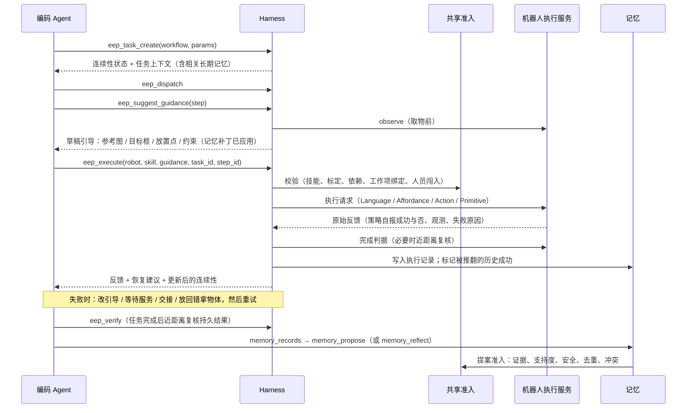

# 架构：GenieMaster 公开设计与 OpenGenieMaster 实现对照

本文逐项对照 GenieMaster 已公开的设计（来源：项目主页 [genie-master.github.io](https://genie-master.github.io/) 的 `main` / `dev` 分支页面、架构图与实验图，以及 2026-10-27 的公开报道）和本仓库的实现。凡是本项目自行补全的部分，都标注为**本项目设计**。

## 1. 架构演进的定位

GenieMaster 主页的概览图（FIG. 02）把架构演进分成三代：

1. **Action Policy**：端到端策略，输入直接映射到动作。
2. **Dual-System**：VLM 规划 + Action Policy 控制。
3. **GenieMaster：Embodied Continual Harness**。由 Domain、Embodiment 和 Coding Agent 组成 Harness，通过 EEP 连接 Action Policy、WBC Control 和 Motion Primitives。

本仓库的评测把前两代实现为基线：`vanilla_vla` 和 `dual_system`。第三代即 Harness 本身。

## 2. 组件对照

架构图（FIG. 01，`assets/geniemaster-architecture.png`）中的每个方框在本仓库都有对应实现：

| 架构图组件 | 公开描述 | 本仓库 | 说明 |
| --- | --- | --- | --- |
| External Interfaces：Bounding Boxes / Speech / Merchant Database / Goal Image | 外部输入 | `domain/records.py` 的 `BusinessRecords`（商户目录、参考图 URI、货架图、订单）；`Guidance.spatial`、`Guidance.references` | 语音输入未实现，由编码 Agent 自行转写 |
| Domain：Task Semantics / Composed Commands / Materials & Business Records → Task Criteria | 领域工作流表达任务语义 | `domain/base.py` 的 `Domain`、`Workflow`、`ComposedTool`；`domain/store.py`、`office.py`、`home.py` | 工作流把参数展开成与机器人无关的 `StepTemplate`；判据见 `DEFAULT_CRITERIA` |
| Embodiment：Robot Instance / Robot Bindings / Calibration | 把工作流绑定到具体机器人、标定与执行服务 | `embodiment/profiles.py`（特性与技能 → 执行服务绑定）、`embodiment/robots.py`（`RobotInstance`、`Calibration`、`Fleet`） | G1、G2、ARX 用通用档案 `wheeled_humanoid`、`dual_arm_cart` 近似 |
| Shared Admission：Validate · admit | 共享准入 | `harness/admission.py` | 准入规则为**本项目设计**，见第 5 节 |
| Memory：Domain Memory / Embodiment Memory | 两类记忆 | `memory/store.py` 的 `MemoryEntry.scope ∈ {domain, embodiment}` | — |
| Coding Agent（CC / Codex / Kimi K3 / DeepSeek Harness） | 编码 Agent 位于 Harness 中心 | `agents/mcp_server.py`（任意 MCP Agent）、`agents/llm_agent.py`（内置 Claude）、`harness/orchestrator.py`（无 LLM 的确定性实现） | 三者调用同一组 EEP 操作 |
| Task Context：Domain goal & limits | 任务上下文 | `Harness.task_context()` | 包含连续性、安全规则、下一步和相关记忆 |
| Orchestrate | 编排 | `Harness.dispatch()` + 编排器 | 工作项分组绑定机器人，按最早空闲机器人调度 |
| Execution Feedback：Criteria & evidence | 判据与证据 | `Harness.execute()` + `harness/criteria.py` | 策略报告成功但判据未通过时，按失败处理 |
| Recovery | 失败后恢复 | `harness/recovery.py`（恢复动作词表与预案）+ 编排器 | 恢复动作词表为**本项目设计** |
| Reflection：Reflect & revise | 反思 | `memory/reflection.py`（规则 / LLM）+ `memory_records` / `memory_propose` 工具 | — |
| Agent—Robot 双向通信：Execution Requests（Language / Affordance / Action / Primitives） | 四种请求形态 | `ExecutionMode` 枚举、`SkillSpec.service` | — |
| Evidence：Execution / Success / Progress / Observation | 返回证据 | `Feedback`（`action_result`、`success`、`progress`、`observation`、`failure_reason`、`criteria`） | — |
| Execution Services：Policy Inference / Robot Control；Execution Adapters | 执行服务与适配器 | `embodiment/adapters.py` 的 `SimAdapter`、`HttpAdapter`、`ReplayAdapter`；`embodiment/service.py`（机器人端服务） | HTTP 契约为**本项目设计** |
| Support for Heterogeneous Robots | 异构机器人 | 多个档案 + `Fleet.capable()` | — |
| Replay · Offline tests | 回放与离线测试 | `replay.py` | — |

## 3. EEP 四类契约

主页 `dev` 分支对四类契约的说明，以及本仓库中的对应位置：

| 契约 | 公开说明（摘要） | 公开字段 | 本仓库 |
| --- | --- | --- | --- |
| Capability | 领域工具组合出导航、抓取、放置等工作流（示例：`inspect_shelf` + `restock`）；具身工具把它们绑定到选定的机器人、标定和执行服务（示例：`robot=G1` + `calibration` + `execute`） | — | `CapabilityContract`；工具 `eep_capabilities`、`store_inspect_shelf`；工作流 `restock`、`retrieve`、`clean`、`fetch_items`、`serve_guests`、`spread_tablecloth` |
| Guidance | 除当前观测和子任务指令外，Agent 还可下发细粒度语言、位置框 / 点、物体参考图 | — | `Guidance`：`instruction`、`detailed`、`constraints`、`spatial`（box / point / region / trajectory，含 role）、`references`、`camera`、`arm`、`approach`、`options` |
| Feedback | 返回最新观测、机器人状态和成功 / 失败证据，供 Agent 推进、改引导或恢复 | `observation` + `action_result` + `failure_reason` | `Feedback`，字段名保持一致 |
| Continuity | 分配、进度、依赖和未完成工作跨调用保留；机器人中途停下后，下一次调用拿到任务状态、已完成步骤、手持物和未满足依赖，由其他空闲机器人接着做 | `task_id` + `completed_steps` + `assigned_robot` + `pending_work` | `ContinuityState`，另含 `held_objects`、`dependencies`、`assignments`、`steps` |

## 4. 一次执行的完整路径



## 5. 本项目补全的设计

以下内容未见于官方公开材料，由本项目自行设计：

- **线格式与版本**：`open-eep/0.1`。JSON 对象中缺省字段省略；未知字段必须忽略，以便向前兼容。错误分两层：物理失败码（`FailureReason.code`，见 `eep/errors.py`）和协议错误（`EEPError`）。
- **准入规则**：
  - 执行请求：机器人状态、技能是否存在、标定是否有效、空间提示坐标是否合法、步骤与技能是否一致、依赖是否完成、工作项是否被持物机器人绑定，以及人员闯入联锁（最近观测到有人且未声明 `pause_on_intrusion` 时，拒绝操作类技能）。
  - 记忆提案：
    - 模式校验，包括 `when` 和 `patch` 的值类型。
    - 证据只计**互不重复的执行记录**：Agent 写的备注不算，记录须与提案的 `domain`、`robot_model` 一致。支持度门槛为反思 ≥ 2、Agent 提案 ≥ 1、安全类 ≥ 1。
    - 来源（`source`）由调用路径决定，提案作者不能自称 `human`。
    - 安全开关（`pause_on_intrusion`、`keep_gripper_closed`）在补丁及其 `options` 中只能为 `true`；取代安全条目的新条目必须保留全部安全行为。
    - 去重合并：已有更通用、补丁相同的条目时，新的更具体提案只合并证据。
    - 冲突拒绝或显式取代；条目数量有上限。
- **恢复词表**：例如 `use_wrist_camera`、`add_reference`、`add_target_box`、`verify_close_range`、`keep_gripper_closed`、`pause_on_intrusion`、`wait_for_service`、`handoff`、`put_back`、`reposition`、`add_arm_assignment`、`search_elsewhere`。反思把“反复奏效的恢复”固化为首选引导，这正是主页“经验转化为更好执行”的机制。
- **被推翻的成功（contradiction）**：例如抓取成功后，后续步骤发现夹爪是空的（运输途中掉落）；搜索结果在取物时站不住脚；收尾复核时近距离判据不通过。这些情况会把原先的成功记录标记为被推翻，为判据类经验（“近距离复核”）提供证据。论文提到“反思让 7 个检测器中 6 个的完成边界更准确”，本仓库以此类证据实现同一方向。
- **工作项绑定（step group）**：取物 → 搬运 → 放置这一组步骤必须由同一台机器人完成。交接时如果原机器人仍持有物体，默认拒绝；强制交接时，整个工作项（含已完成步骤）转给新机器人从头重做，并在任务备注中提示原机器人放下手中物体。
- **完成状态可回退**：收尾或近距离复核发现某个必需步骤其实失败了，已完成的任务会回到进行中，不会误报完成。
- **急停与中断的区别**：动作服务宕机时，任务转为 `interrupted`，编排器等待后可自动续接；操作员急停时，任务转为 `paused`，必须显式恢复。准入拒绝的步骤会被标记为失败，调度器不会在同一个请求上空转。
- **能力缺口与练习**：按（领域、技能、机型、显著标签）聚合最近的执行记录。失败率 ≥ 30%、每次成功平均尝试次数 ≥ 1.6 或明显偏慢时，判定为缺口；空闲时生成“取出再放回”的练习任务。
- **Policy RSI 数据导出**：只导出策略服务类技能。剔除被推翻的成功；经恢复才成功的样本加权；重复样本按 1/√n 降权；抓错物体的成功抓取做目标重标（hindsight relabel）。

## 6. 三种编码 Agent 的关系

| 编码 Agent | 适用场景 | 说明 |
| --- | --- | --- |
| 外部 Agent 经 MCP（Claude Code、Codex 等） | 研发、调试、人机协作 | 最接近 GenieMaster 的形态：通用编码 Agent 直接调用 EEP 工具 |
| 内置 Claude Agent（`ogm agent`） | 无需外部 Agent 的自动运行 | 在 Messages API 上手写工具循环；默认 `claude-opus-5-5`，开启服务端 fallback |
| 脚本编排器（`ScriptedOrchestrator`） | 测试、离线评测、真机上的兜底 | 确定性；用同一套恢复词表、记忆补丁和判据。论文中的基线也由它的不同配置实现 |

## 7. 记忆的生命周期

```text
执行记录（临时记忆，records.jsonl，追加写）
   │  失败码 / 证据 / 恢复动作 / 判据结果 / 标签 / 被推翻标记
   ▼
反思（规则反思器或 LLM / 编码 Agent；按周期或任务后）
   │  提案：scope、kind、text、when（适用条件）、patch（可机读补丁）、evidence
   ▼
共享准入（validate · admit · merge · reject）
   ▼
长期记忆（long_term.json + versions/vNNNN.json + history.jsonl）
   │  按 when 匹配；越具体优先级越高；应用后统计 applied / succeeded
   ▼
下一次规划：任务上下文中的说明 + 引导补丁（摄像头、约束、近距离复核、搜索顺序、派工偏好、恢复顺序）
```

长期记忆可以检视、比较和回滚：`ogm memory list|history|diff|rollback|retire --state-dir .ogm`。反思时，应用 ≥ 6 次且成功率 < 35% 的条目会被自动退役（安全类条目除外）。
